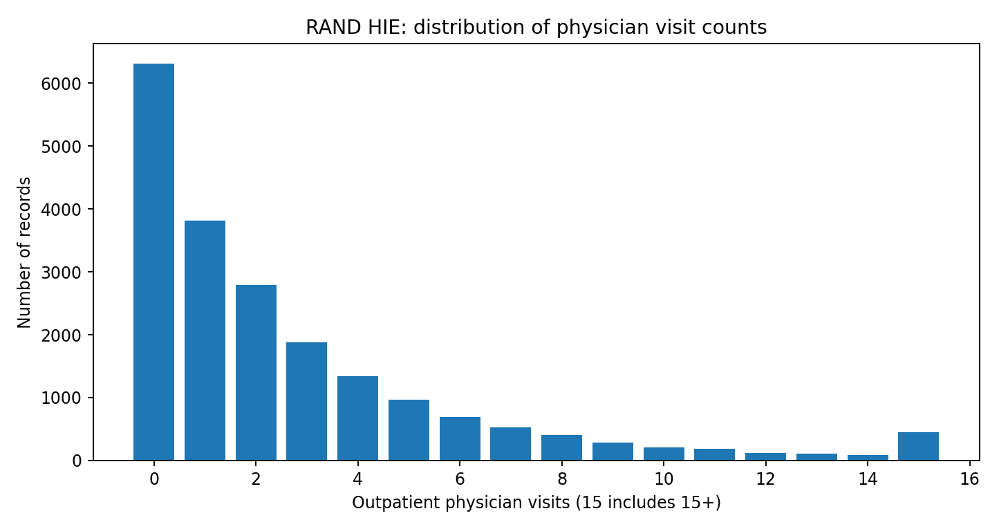
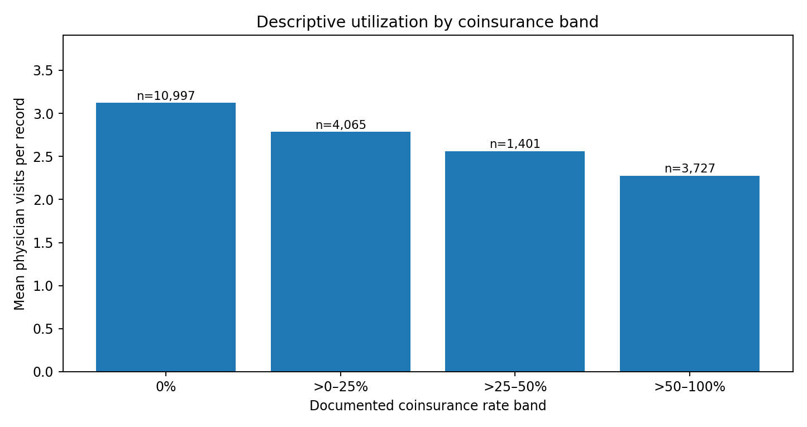

# Research Data QA & Reporting | RAND Health Insurance Experiment

**A reproducible healthcare research analytics case study:** ETL, record reconciliation, SQL quality audit, statistical modeling, and sponsor-style reporting.

> **Portfolio case study, not an institutional research project.** Uses an open historical dataset, not UT Health San Antonio patient records. Results do not support individual medical advice or causal claims.

## Research question

How do annual outpatient physician-visit counts vary across insurance cost-sharing bands and self-reported health categories? How does overdispersion affect exploratory count-model fit?

## Verified findings

| Metric | Reproduced result |
|---|---:|
| Source records / records reconciled | **20,190 / 20,190** |
| Records in complete-case analysis | **20,190** |
| No physician visits recorded | **31.24%** |
| Mean / median physician visits | **2.860 / 1** |
| Variance-to-mean ratio | **7.09** |
| Poisson / negative-binomial in-sample AIC | **125,924.95 / 87,031.00** |
| Nonbinary values in nominally binary `physlm` field | **1,052** |
| Fractional values in nominal disease-count `disea` field | **18,396** |
| Unit tests | **3 passing** |

The lower negative-binomial AIC is consistent with pronounced overdispersion. It does **not** demonstrate out-of-sample accuracy, a treatment effect, or valid patient-level inference.

## Visual results





## Why this is relevant to clinical research operations

| Job requirement | Evidence in this project |
|---|---|
| Compile and reconcile study data | Keyed merge with explicit one-to-one cardinality check and reconciliation counts |
| Use programming to extract, manipulate and analyze datasets | Python / pandas / statsmodels ETL and count models |
| Maintain accurate, audit-ready data | Field-level missingness, range checks, exception log and executable SQL |
| Report to PIs and study stakeholders | [Research progress report](outputs/research_progress_report.md) |
| Prepare reports and dashboards | Two figures, [reporting table](data/dashboard_table.csv) compatible with Tableau and Power BI |
| Collaborate on research definitions | [Data dictionary](docs/data_dictionary.md), [methods and limitations](docs/methods.md) |
| Deliver reproducible analysis | Three automated pytest tests and GitHub Actions CI |

## Reproduce

Requires Python 3.11+ and internet access *only to install Python packages*. The RAND HIE dataset is bundled with `statsmodels`, so the analysis does not require an external data download.

```bash
python -m venv .venv
source .venv/bin/activate          # Windows: .venv\Scripts\activate
pip install -r requirements.txt
python src/pipeline.py
pytest -q
```

Outputs are committed so the report can be read without running code. Re-running should regenerate `outputs/*.json`, `outputs/*.csv`, `data/dashboard_table.csv`, `figures/*.png`, and `outputs/research_progress_report.md`.

## Repository map

- `src/pipeline.py` — audited ETL, descriptive analysis, exploratory Poisson/NB2 models, visuals and progress report
- `sql/qa_checks.sql` — executable SQL verification query
- `tests/test_pipeline.py` — linkage, data constraints and reporting-denominator tests
- `docs/data_dictionary.md` — variable semantics and discovered coding ambiguity
- `docs/methods.md` — study rationale, analysis choices, interpretation limits
- `outputs/quality_audit.json` — record count and missingness audit
- `outputs/analysis_summary.json` — calculated descriptive and diagnostic statistics
- `outputs/research_progress_report.md` — report ready to discuss in a research-operations interview
- `data/dashboard_table.csv` — denormalized, Tableau/Power BI-importable aggregate dataset
- `.github/workflows/ci.yml` — reproduce analysis in CI

## Source and attribution

RAND Health Insurance Experiment (HIE), **10-variable public-domain subset** made available as `statsmodels.datasets.randhie`. Documentation: [statsmodels dataset reference](https://www.statsmodels.org/stable/datasets/generated/randhie.html). Original data were collected by RAND and used by Cameron & Trivedi (2005). The 20,190 rows are **records**, not proven distinct patients. See [methods](docs/methods.md) for why this matters.

**Authorship disclosure:** This portfolio demonstration was created with AI assistance; the analysis code, output, test results, and limitations are included for independent review.
