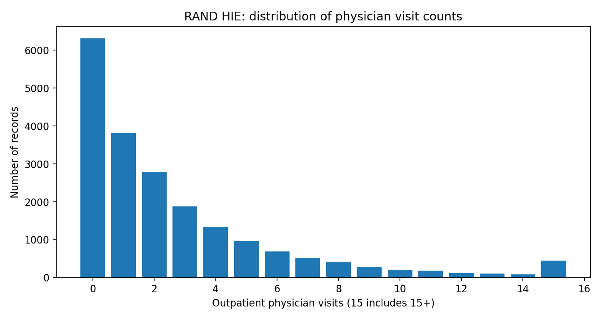
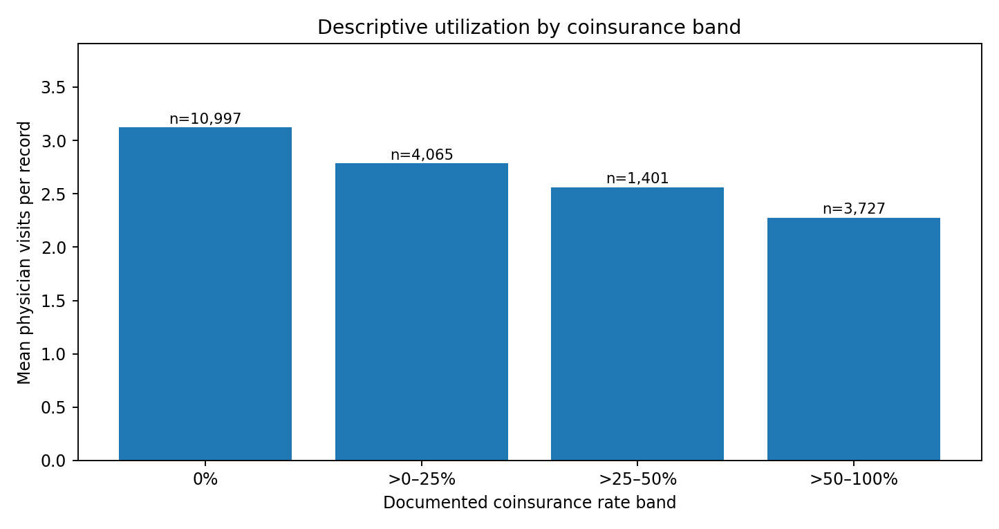

# Research data quality and analytic progress report

**Dataset:** RAND Health Insurance Experiment (HIE), public 10-variable subset shipped with `statsmodels`  
**Purpose:** Demonstrate clinical-research data management, reproducible analysis, SQL QA, and report-ready visualization.  
**Status:** PASS (automated checks)  
**Scope:** Historical observational summaries of records from a randomized insurance experiment; **not** a causal effect analysis.

## Executive summary

- **20,190** public records loaded; **20,190** used for complete-case exploration.
- Average outpatient physician visits per record: **2.860**; median **1**.
- **31.24%** of records show zero outpatient physician visits.
- Count variance / mean: **7.09**, indicating substantial overdispersion relative to a simple Poisson count model.
- Duplicate synthetic record IDs, negative visit counts, and contradictory health-status flags: **0**, **0**, **0**, respectively.

## Deliverable 1: Reconciled analytical extract

The original public dataset was separated **for demonstration purposes** into coverage and outcome views, then rejoined on a generated *row surrogate* with one-to-one validation. This is a reproducible reconciliation exercise, **not** linkage of independently collected clinical data. Missingness, coverage, key uniqueness and field constraints are logged in `outputs/quality_audit.json`.

## Deliverable 2: Descriptive results

| Coinsurance band | Records | Mean physician visits |
|---|---:|---:|
| 0% | 10,997 | 3.124 |
| >0–25% | 4,065 | 2.787 |
| >25–50% | 1,401 | 2.561 |
| >50–100% | 3,727 | 2.276 |

The grouped data in `data/dashboard_table.csv` includes health-status strata, record counts, mean visits, and percentage of records with zero visits. Differences are descriptive, not estimates of causal benefit or harm.

## Deliverable 3: Exploratory model checks

Two count models were fit to the **same complete-case records** with documented covariates: log(coinsurance + 1), deductible-plan indicator, the documented disease-burden measure, and self-rated-health indicators. The ambiguous `physlm` field is omitted from modeling.

| Model | In-sample AIC | In-sample MAE |
|---|---:|---:|
| Poisson GLM | 125,924.95 | 2.608 |
| Negative binomial NB2 | 87,031.00 | 2.612 |

Estimated NB2 dispersion parameter alpha: **1.3177**. These are **in-sample** fit diagnostics, not external validation. No clinical predictive accuracy, p-values, or causal effects are claimed.

## Data-definition exception detected

The source documentation calls `physlm` a binary flag and `disea` a chronic-disease count, yet **1,052** physical-limitation values are nonbinary and **18,396** disease-burden values are fractional. The pipeline flags these for source-owner clarification instead of silently coercing data. `physlm` is excluded from modeling. `disea` is treated as a continuous source-coded covariate, not interpreted as a literal count.

## Audit and interpretation limitations

1. The public 10-variable extract omits individual, family, site, and study-year identifiers. Repeated person-year observations may exist and cannot be identified. Consequently, standard errors, cluster-robust inference, and subject-wise train/test splits would be inappropriate here.
2. The experiment is historical and the analytic extract is a subset of the original RAND HIE. Results do not describe contemporary patients.
3. Coinsurance bands are derived by reversing the documented log transformation and are presented descriptively. Differences across bands can reflect covariates and design effects.
4. No inference about intervention effectiveness, disease progression, or individualized care is supported.
5. The demonstration intentionally tests linked *views of the same dataset*. A production study would use source-system lineage and independent key validation.

## Recommended next study iteration

Obtain a permitted version with unique participant IDs, year, site, and randomization unit; then write a prespecified analysis plan, estimate person/family-clustered uncertainty, document missing-data assumptions, and conduct appropriate sensitivity analyses. For a laboratory deployment, replace the illustrative views with actual separate extracts and reconcile them under a data-use agreement.

## Reproduction and deliverable checklist

- [x] Public source documented and reloadable from a pinned Python package
- [x] Record-level join audit and missingness inventory
- [x] Schema checks and executable SQL validation
- [x] Descriptive table with denominators and data lineage
- [x] Predeclared exploratory model specification, diagnostics, and limitations
- [x] PNG exhibits and Tableau/Power BI-importable aggregate CSV
- [x] Unit tests and GitHub Actions CI configuration
